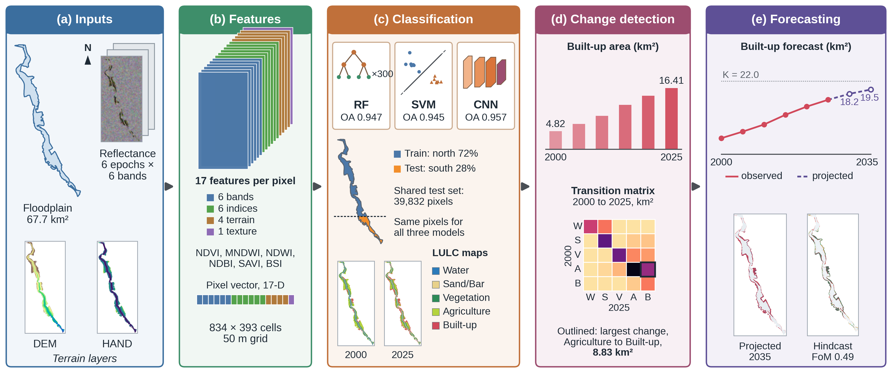

# Mapping and Forecasting Spatiotemporal Encroachment Dynamics in the Delhi Yamuna Floodplain

Code, data, figures and LaTeX source for the IEEE Transactions manuscript of the
same title, by Prachi, Rahul Katarya and Kailash Chand Tiwari
(Delhi Technological University).

The study maps five-class land cover over the active floodplain of the river
Yamuna in Delhi for six epochs between 2000 and 2025, quantifies built-up
encroachment by post-classification change detection, and forecasts its areal
and spatial growth to 2035 with a logistic growth model coupled to a
driver-based cellular-automata allocation. Three classifiers (Random Forest,
RBF support-vector machine, and a fully-convolutional CNN written from scratch
in NumPy) are scored on one identical, spatially disjoint hold-out.



## Data provenance (read this first)

The **floodplain boundary is real**: `data/yfp7_digi.shp` is the digitized
active-floodplain polygon of the Delhi reach (Palla/Wazirabad to Okhla),
EPSG:32643, area 67.7 km², 71.8 km² once rasterized to the 50 m analysis grid.

The **multi-temporal imagery is not**. Analysis-ready multi-date Landsat and
Sentinel-2 surface-reflectance scenes could not be retrieved in the offline
environment this work was carried out in. Rather than substitute unverifiable
imagery, the pipeline runs on a **controlled benchmark**: a six-epoch (2000,
2005, 2010, 2015, 2020, 2025), six-band reflectance cube with exact five-class
land-cover labels, synthesized over the real floodplain geometry and its urban
surroundings, and designed to reproduce qualitative characteristics of the Delhi
reach reported in the literature.

Every metric in the paper and in this repository is a genuine experimental
result computed on that benchmark. None of them is a measurement of the physical
river: they are properties of the model-benchmark system. The benefit of the
design is that ground truth is exact, which permits leakage-controlled accuracy
assessment that sparsely-annotated real imagery does not support. The cost is
that operational conclusions about the actual Yamuna require real imagery.

The pipeline consumes analysis-ready reflectance directly, so replacing Stage B
with atmospherically-corrected Landsat or Sentinel-2 composites (for example via
Google Earth Engine) yields an operational system with no change to any
downstream stage. Section III-B of the paper states this in full.

## Repository layout

```
data/        Real digitized active-floodplain polygon (ESRI shapefile, EPSG:32643)
src/nn.py    Pure-NumPy CNN building blocks: im2col conv with verified backward
             pass, ReLU, pixel-wise softmax cross-entropy, Adam
notebooks/   yamuna_encroachment.ipynb, the executed end-to-end pipeline
figures/     The 12 figures the notebook writes and displays (PNG)
paper/       Self-contained IEEEtran LaTeX project plus the compiled PDF
docs/        Revision log: every change made during review, with its reason
scripts/     prepare_workspace.sh, sets up the paths the notebook expects
```

## Results on the controlled benchmark

Classification, shared spatial hold-out of 39,832 pixels drawn from grid rows
600 to 833 (the northern 72% of the grid supplies training pixels only):

| Model | Overall accuracy | Cohen κ | Macro-F1 |
|---|---|---|---|
| Random Forest (300 trees) | 0.9471 | 0.9334 | 0.9514 |
| SVM (RBF, C=10) | 0.9449 | 0.9307 | 0.9490 |
| CNN (fully-convolutional) | **0.9572** | **0.9462** | **0.9593** |

Floodplain built-up area from the Random Forest maps, km² (percentage of the
71.8 km² rasterized floodplain):

| | 2000 | 2005 | 2010 | 2015 | 2020 | 2025 |
|---|---|---|---|---|---|---|
| Built-up (km²) | 4.82 | 6.80 | 8.95 | 11.87 | 14.35 | 16.41 |
| Built-up (%) | 6.7 | 9.5 | 12.5 | 16.5 | 20.0 | 22.9 |

Forecast: logistic fit (RMSE 0.110 km², against 0.222 exponential and 0.234
linear) with K = 22.02 km², r = 0.0950 yr⁻¹, t₀ = 2013.6, projecting 18.2 km²
(25.4%) by 2030 and 19.5 km² (27.1%) by 2035, with 90% bootstrap bands of
[17.8, 18.5] and [18.9, 20.0] km². Hindcast (trained on 2000 to 2015
conversions, allocating the mapped 2015 to 2025 demand): 87.1% built-up cell
agreement against the 2025 Random Forest map and a Figure of Merit of 0.492
(3,189 hits, 1,846 misses, 1,445 false alarms).

Two caveats that the paper states and that any reader of this repository should
carry: the evaluation pixels are drawn from the whole analysis grid, so built-up
reference pixels include urban fabric outside the floodplain; and in 2025 the
Random Forest maps give 16.41 km² of floodplain built-up against a benchmark
reference of 23.51 km², an under-detection of about 30%, whereas the CNN gives
23.70 km², within 1%. Change detection and forecasting are driven by the Random
Forest maps, so those figures are conservative.

## Reproducing the pipeline

```bash
python -m venv .venv && source .venv/bin/activate
pip install -r requirements.txt
bash scripts/prepare_workspace.sh          # see note on paths below
jupyter lab notebooks/yamuna_encroachment.ipynb
```

Run the cells in order, Stage A through the figure cells. Random seeds are fixed
throughout, so every number and figure is deterministic and reproduces exactly.
Stages A and B cache their arrays as `.npy` under `data/`, which later stages
load instead of recomputing; those intermediates are gitignored.

The CNN module carries its own gradient check:

```bash
python src/nn.py
# Conv dX grad-check max rel err = 1.96e-08  (OK)
# Conv dW grad-check max rel err = 1.88e-08  (OK)
```

**A note on paths.** The notebook is committed exactly as it was executed, so
its outputs correspond cell-for-cell to its source. That executed version begins
with `os.chdir("/home/claude/yamuna")` and resolves `data/`, `src/` and
`figures/` beneath it. `scripts/prepare_workspace.sh` creates that directory and
links this checkout into it, so the notebook runs unmodified. If you would
rather not have a path under `/home/claude`, change that single `os.chdir` line
in the first code cell to point at your clone; nothing else in the notebook uses
an absolute path.

## Building the paper

`paper/` is a self-contained IEEEtran project: upload the whole directory to
Overleaf, or build locally with

```bash
cd paper
pdflatex paper && bibtex paper && pdflatex paper && pdflatex paper
```

It needs the `IEEEtran` class and `IEEEtran.bst` (TeX Live: `texlive-publishers`).
The current build is 11 pages with 62 references, no undefined references, no
overfull boxes and no BibTeX warnings. `paper/Yamuna_Encroachment_IEEE.pdf` is
that build.

The figures the paper includes are duplicated into `paper/` so that the LaTeX
project compiles standalone. Four of them are vector PDFs (`fig_pipeline.pdf`,
`fig6_cnn.pdf`, `fig7_areas.pdf`, `fig9_forecast.pdf`) rather than the PNGs in
`figures/`. `fig_pipeline.pdf`, the framework diagram that is Fig. 1 of the
paper, is drawn separately and is not an output of the notebook.

Notebook figure numbering predates the paper's, so they differ:

| Notebook | Paper | File |
|---|---|---|
| (not in notebook) | Fig. 1 | `fig_pipeline.pdf` |
| Fig. 1 | Fig. 2 | `fig1_studyarea.png` |
| Fig. 2 | Fig. 3 | `fig2_multitemporal.png` |
| Fig. 3 | Fig. 4 | `fig3_inputs.png` |
| Fig. 4 | Fig. 5 | `fig12_rf_maps.png` |
| Fig. 5 | Fig. 7 | `fig4_rf_cm_fi.png` |
| Fig. 6 | Fig. 6 | `fig5_modelcomp.png` |
| Fig. 7 | Fig. 8 | `fig6_cnn` |
| Fig. 8 | Fig. 9 | `fig7_areas` |
| Fig. 9 | Fig. 10 | `fig8_transition.png` |
| Fig. 10 | Fig. 11 | `fig9_forecast` |
| Fig. 11 | Fig. 12 | `fig10_future.png` |
| Fig. 12 | Fig. 13 | `fig11_hindcast.png` |

## Submission notes

The manuscript is under review at IEEE Transactions on Geoscience and Remote
Sensing. Two points that matter if you edit `paper/paper.tex`:

**The title must not claim satellite imagery.** A version submitted in November
2026 carried the title "Mapping and Forecasting Spatiotemporal Encroachment
Dynamics in the Delhi Yamuna Floodplain Using Multitemporal Satellite Imagery".
The trailing clause was removed: no satellite imagery was used, as Section III-B
and the provenance statement above both state, so that clause contradicted the
paper's own methods section. The current title is the rest of that sentence,
unchanged.

**Author affiliations must stay in `\thanks{}` blocks.** The IEEE journal
template requires the first page to carry a footnote with author institution
information. Putting the affiliations inline under the author names, which is
the IEEEtran conference layout, produces no such footnote and the submission is
returned. `docs/revision-log.md` records this.

## Citing

The manuscript is unpublished and under preparation; see `CITATION.cff` for an
interim entry. Copyright in the manuscript and figures rests with the authors.
No software licence has been chosen yet, so no reuse permissions are granted by
this repository beyond those that GitHub's terms of service confer.
